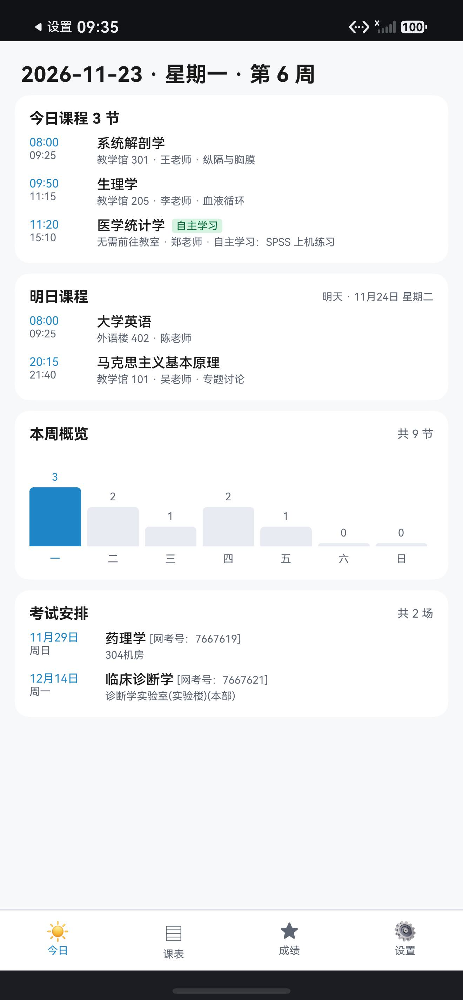
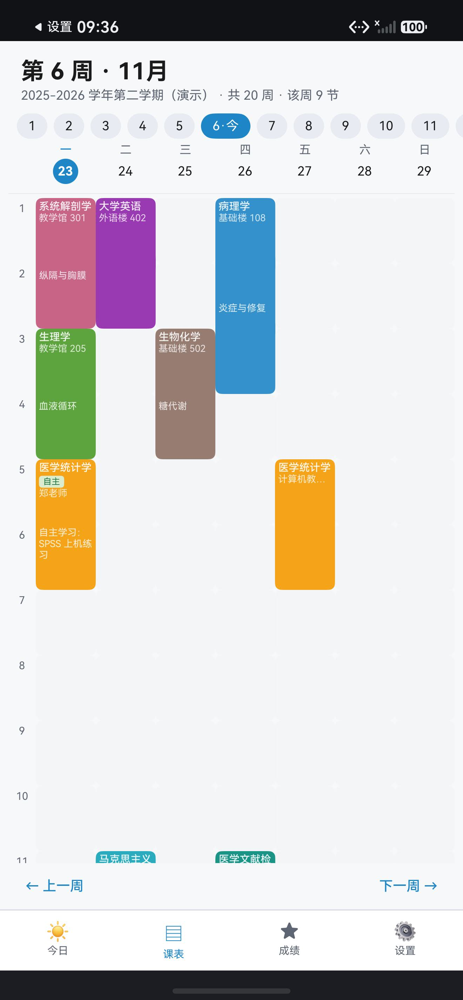
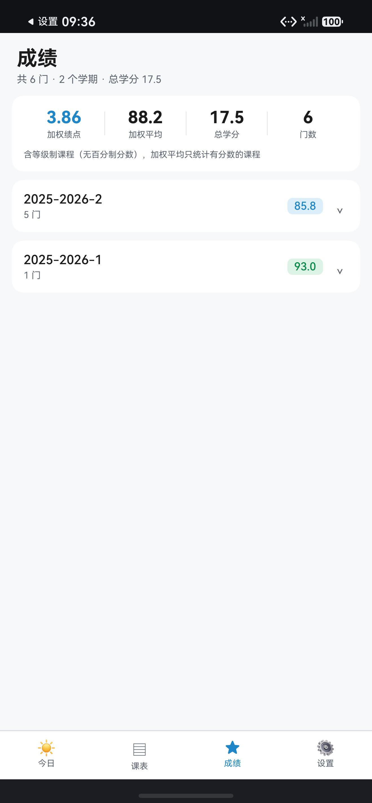
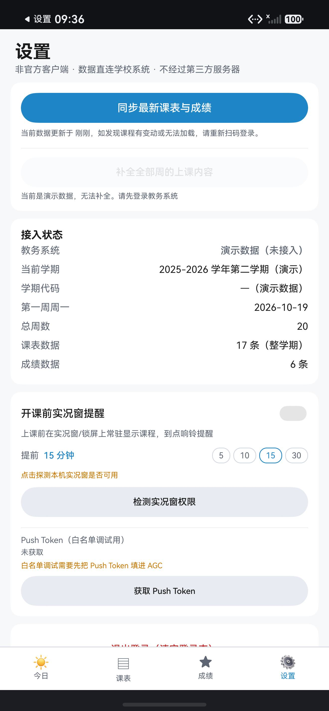
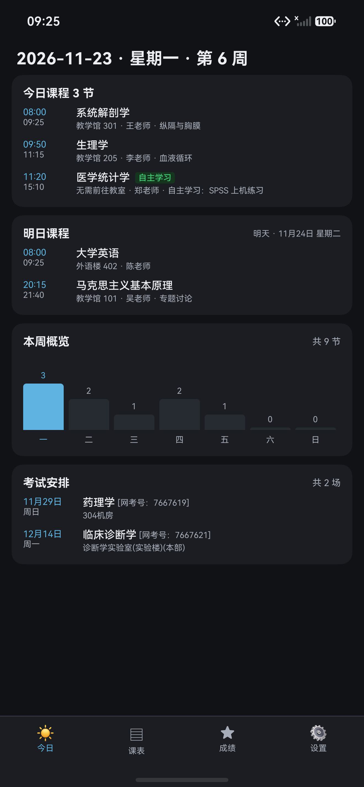
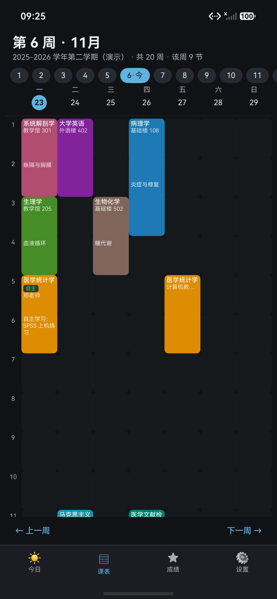
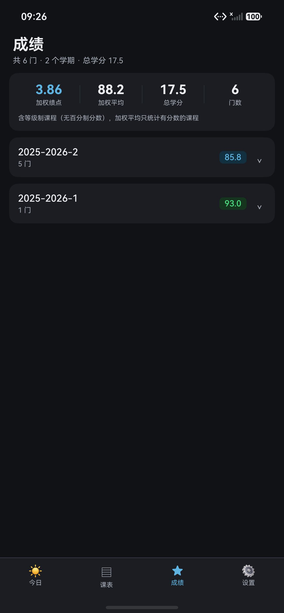
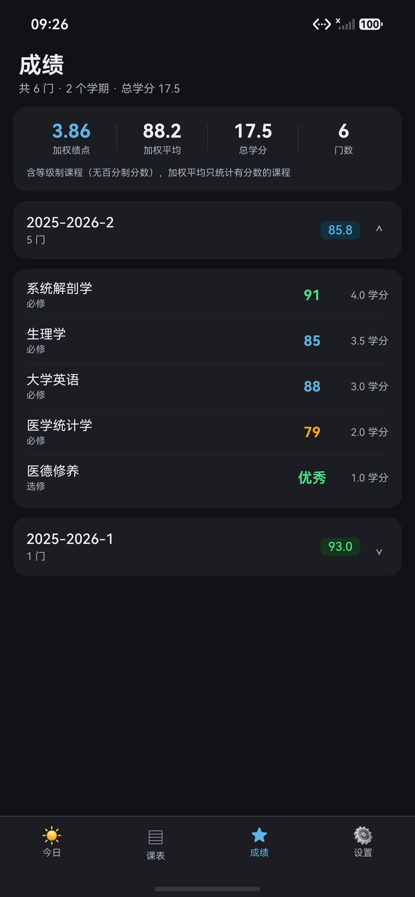

# 南医大口袋 · 鸿蒙版

> 南方医科大学学生课表 / 成绩查询应用的 **HarmonyOS NEXT 原生客户端**
>
> 从 Android 版 [1812355417/smu-pocket](https://github.com/1812355417/smu-pocket) 完整移植到**纯 ArkTS / ArkUI**


> 💡 **想装未签名的鸿蒙包？** 本项目发布的是**未签名**的 HAP，无法直接安装。
> 想快速在真机上装上体验，可以关注学习 GitHub 上的开源项目
> **「小白调试助手」**——它能帮助你对未签名包做本地签名并安装。
> 在 GitHub 搜索「小白调试助手」即可找到。

---

## 特性

### 四个主页面

| 页面 | 能力 |
|---|---|
| **今日** | 今日课程 · 明日课程（自动处理跨周）· 本周概览柱状图 · 考试安排（含网考号）|
| **课表** | 固定 14 节网格 · 按周切换 · 跨节合并 · 自主学习标注 · 标题带月份与日期 |
| **成绩** | 按学期折叠 · 加权绩点 / 加权平均 / 总学分 · 分档配色 |
| **设置** | 手动同步 · 接入状态（已接入 / 离线缓存）· 退出登录 |

### 桌面服务卡片

长条卡片（2×4）**左右分栏显示今天 / 明天**，每门课显示
「课程名 · 时间 · **授课老师** · **上课内容**」，两栏可**各自独立上下滑动**，
30 分钟自动刷新并在跨零点后自动切换到新的一天。

### 做到实处的细节

| 特性 | 说明 |
|---|---|
| **扫码登录** | 用 Web 组件打开学校登录页，用户扫码；**App 不接触密码**，只接管 cookie |
| **整学期记忆** | 登录一次缓存 220 条课程覆盖 1–20 周；**登录失效后翻周、看课表、看成绩全部照常** |
| **离线每日更新** | 离线状态下今日页按**真实日期**实时算当天课表，不会停在缓存那天 |
| **每门课专属颜色** | 教务只给 4 种色且同课异色，本项目按课程名哈希 + 冲突探测自己分配（14 色调色板，实测 11 门课零碰撞，跨周稳定）|
| **深色模式** | 跟随系统，四个页面 + 登录页 + **桌面卡片**全部适配；底部系统栏与 App 无缝衔接 |
| **课程内容合并** | `sknrjj` 只有按周查询才返回（实测 16/16），整学期总表仅 43/220；每次联网把富字段合并进缓存，越用越全 |

---

## 截图

### 浅色（HUAWEI Mate 80 Pro Max · 1320×2848 实拍）

> 以下截图为**演示数据**（`FakeJw`），课程名、老师、成绩均为虚构。

| 今日 | 课表 |
|---|---|
|  |  |
| **成绩** | **设置** |
|  |  |

### 深色模式

| 今日 | 课表 |
|---|---|
|  |  |
| **成绩** | **成绩（展开）** |
|  |  |

---

## 快速开始

### 环境要求

| 组件 | 版本 |
|---|---|
| DevEco Studio 或 Command Line Tools | 26.0.0.865+ |
| HarmonyOS SDK | **API 26** |
| 系统 | HarmonyOS NEXT 5.0+（开发与验证用 HarmonyOS 7.0.0）|

> ⚠️ **工具链与项目路径必须是纯 ASCII**。
> 放在含中文的目录（如 `D:\下载\`）会报
> `The argument value '...' is not an ASCII value` —— 华为 restool 不接受非 ASCII 路径。

### 编译

```bash
# 命令行构建
hvigorw --mode module -p product=default assembleHap --no-daemon
```

产物在 `entry/build/default/outputs/default/`。

### 安装到手机

**鸿蒙不允许安装未签名的应用**，每个安装包都要用**绑定该设备 UDID** 的调试证书签名。
所以需要先用自己的华为开发者账号生成签名：

```powershell
# 1) 登录（⚠️ 见下方「代理」说明，先清代理变量）
devecocli auth login

# 2) 手机连上 USB 后生成调试证书（会读设备 UDID）
devecocli signature generate --product default

# 3) 编译 + 签名 + 安装 + 启动
devecocli run --device <你的设备序列号>
```

> ⚠️ **代理会阻断登录**：若本机开了 Clash 等代理，`auth login` 会报
> `ERR_TLS_CERT_ALTNAME_INVALID`（`localhost` 回调被代理了）。
> 跑 devecocli 前先清掉代理变量：
> ```powershell
> Remove-Item Env:HTTP_PROXY,Env:HTTPS_PROXY,Env:http_proxy,Env:https_proxy -ErrorAction SilentlyContinue
> $env:NODE_USE_ENV_PROXY='0'
> ```

详细步骤见 **[docs/安装到手机.md](docs/安装到手机.md)**。

> 📌 `build-profile.json5` **故意不含签名配置**：那里会有个人绝对路径
> （`C:\Users\<用户名>\...`）与签名口令，不适合提交到公开仓库。
> 跑 `signature generate` 会自动写回去；只编译不装机时不需要它。

---

## ⚠️ 关于发布 HAP 的重要说明

`dist/` 里提供了两种包，**都不建议直接分发给别人**：

| 文件 | 能否给别人用 |
|---|---|
| `*-unsigned.hap` | ❌ 未签名，任何设备都装不上。只适合你拿来**自己签名** |
| `*-debug-signed.hap` | ❌ **绝对不要分发**。调试证书**绑定了开发者本人的设备 UDID**，别人装了也跑不起来，且可能泄露签名身份 |

**这是鸿蒙的机制限制，不是打包没做好**：

- 调试包只能在**签名时登记过的那台设备**上安装
- 想让别人也能装，必须走 **AppGallery Connect 发布正式证书**，
  且应用要在 AGC 上注册、走审核流程

所以本仓库的定位是**源码项目**：使用者克隆后按上文自己签名安装。
如果你要对外发布，请按华为官方流程申请发布证书，**不要**把调试包传到 Release。

---

## 项目结构

```
smu-pocket/
├─ AppScope/                     应用级配置（bundleName / 版本 / 图标）
├─ entry/src/main/
│  ├─ ets/
│  │  ├─ core/                   模型、日期、周次、学期码、网络、缓存、状态中枢、配色
│  │  ├─ data/                   教务 JSON 解析、映射、真实实现、演示数据
│  │  ├─ ui/                     四个页面 + 登录 + 底部导航 + 通用组件
│  │  ├─ theme/                  深浅两套语义色板
│  │  ├─ entryability/           UIAbility（窗口与系统栏配置）
│  │  ├─ entryformability/       桌面卡片的 FormExtensionAbility
│  │  └─ widget/pages/           卡片 UI
│  ├─ resources/
│  │  ├─ base/profile/           form_config.json（卡片声明）
│  │  └─ dark/element/           卡片深色配色（资源限定词）
│  └─ module.json5               权限、Ability、卡片扩展注册
├─ entry/src/ohosTest/           31 个单元测试（周次换算 / 学期代码 / JSON 解析）
├─ docs/                         开发文档
├─ screenshots/                  实拍截图（light / dark / phone）
└─ dist/                         构建产物（不建议分发，见上）
```

**规模**：29 个 ArkTS 文件 / 约 6 700 行 + 31 个单元测试。

---

## 文档

| 文档 | 内容 |
|---|---|
| **[docs/移植踩坑.md](docs/移植踩坑.md)** | **29 条踩坑记录**（环境 / ArkTS / 运行时 / 卡片），每条都注明症状与修法 |
| [docs/移植说明.md](docs/移植说明.md) | 架构对照、关键设计决定、已知限制 |
| [docs/构建与安装.md](docs/构建与安装.md) | 编译命令、签名流程、真机连接 |
| [docs/安装到手机.md](docs/安装到手机.md) | 装机准备清单、常见问题排查 |
| [docs/深色模式.md](docs/深色模式.md) | 深浅色两套机制、系统栏接缝处理 |
| [docs/Mate80ProMax适配.md](docs/Mate80ProMax适配.md) | 目标机型规格、自适应高度、布局问题 |
| [docs/验证报告.md](docs/验证报告.md) | 实测结果、修复的 bug、可复现脚本 |
| [docs/环境安装.md](docs/环境安装.md) | 从零装工具链 |

---

## 已知限制

1. **仅适配南方医科大学**的强智科技教务系统（`zhjw.smu.edu.cn`）
2. **教务系统可能只在校园网 / VPN 内可达** —— 校外打不开登录页属正常，需连校内网络
3. 需自行用华为开发者账号签名后才能安装（见上文说明）
4. 桌面卡片在**负一屏的卡片预览区不响应手势**，要添加到桌面才能滑动（这是系统行为）
5. 本项目**非官方**，与南方医科大学无隶属关系

---

## 致谢与许可

- 原项目：[1812355417/smu-pocket](https://github.com/1812355417/smu-pocket)（Android / Kotlin + Compose）
- 本项目遵循 **GPL-3.0**（与原项目一致），见 [LICENSE](LICENSE)

> 本项目仅供学习交流与个人使用。数据直连学校系统、不经过第三方服务器，
> 请遵守学校信息系统使用规定，不要高频请求。
